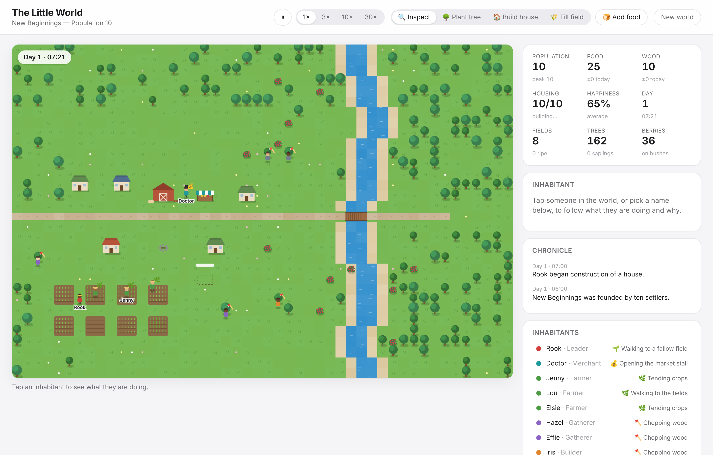
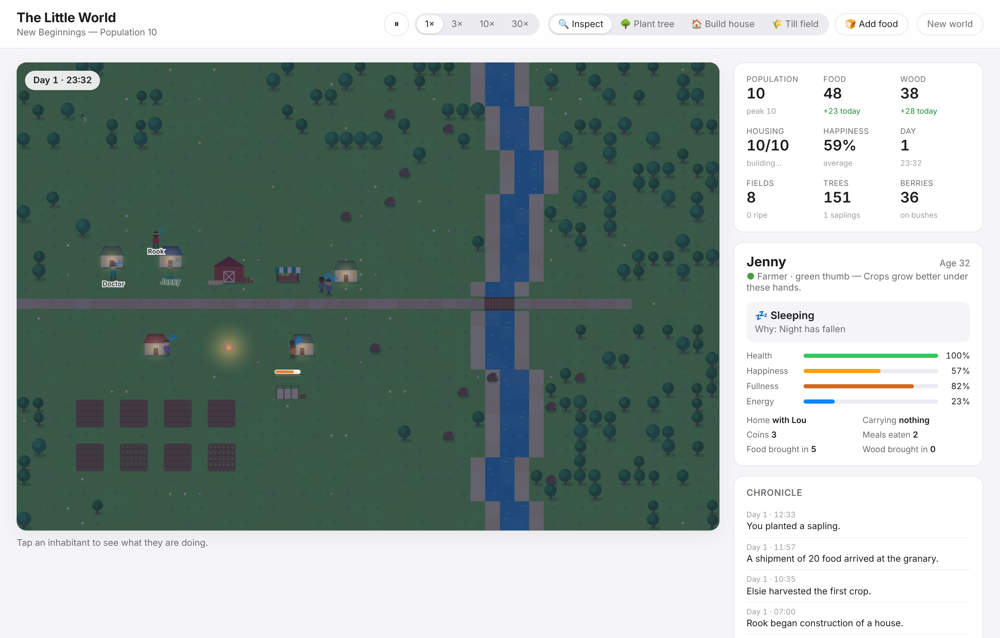
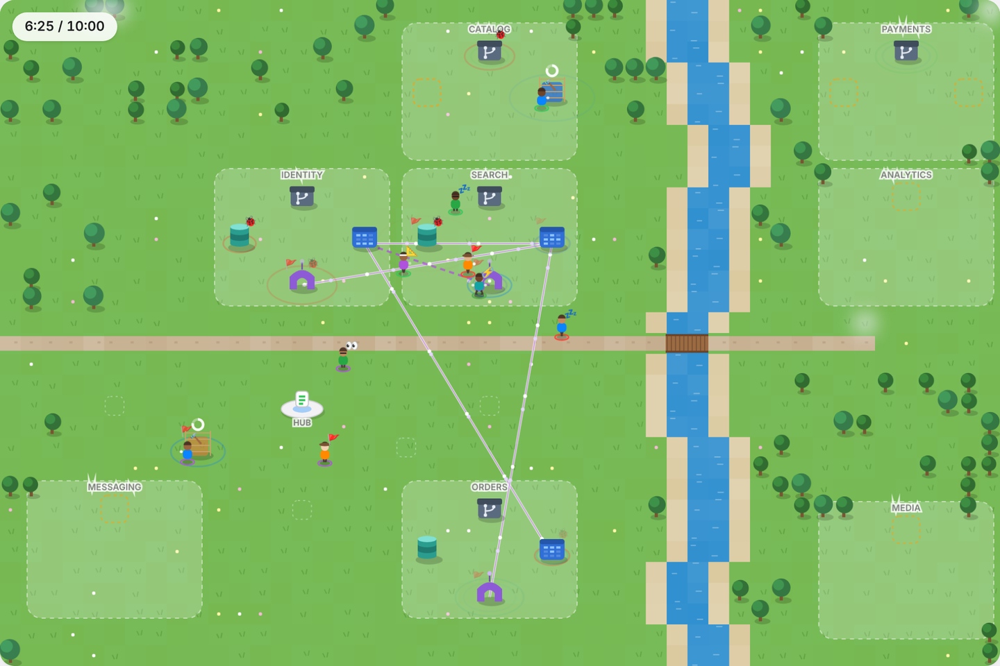

# The Little World · Agent World

Two simulations on one engine. Open the app and **Choose Your World**:

- **[Little World](#the-little-world)**: the original civilization simulation. Ten settlers in New Beginnings.
- **[Agent World](#agent-world)**: an autonomous AI engineering civilization. Ten software agents build an ecosystem through stigmergy and game theory, with no central coordinator.

# The Little World

**A living, evolving civilization you can watch, influence, and come back to.**

Ten settlers. Five houses. A river, a forest, eight fields, and one shared granary. Welcome to **New Beginnings — Population 10.**

Rook runs around organizing everybody. Jenny is trying to feed the village. Doctor has figured out how to charge everyone for the food. You don't control any of them. You plant trees, mark out houses, till fields, send food, and watch what happens.



## Play

No install, no dependencies.

```bash
npm start            # http://localhost:5173
```

Or open `index.html` from any static server and pick **Little World** (`little-world.html`). Works in modern desktop and mobile browsers. The world saves itself to your browser every few seconds; reload and you're back in the same civilization. **New world** starts over.

| Control | What it does |
| --- | --- |
| ⏸ / ▶ (Space) | Pause and resume |
| 1× 3× 10× 30× (keys 1–4) | Speed. At 1× a day takes one real minute. |
| 🔍 Inspect (I) | Tap anyone to see what they're doing **and why** |
| 🌳 Plant tree (T) | Saplings grow in about two days, cheer up nearby homes, and later become lumber |
| 🏠 Build house (H) | Marks a site. Builders still have to haul 16 wood and raise the walls. |
| 🌾 Till field (F) | A new 2×2 field. A farmer will come and sow it. |
| 🍞 Add food | A shipment of 20 food arrives at the granary |
| 🌊 Sound (M) | Cycles Waves + piano → Waves → Piano → Sound off. Starts on your first tap (browser rule). |

`little-world.html?seed=42&fresh` starts a reproducible world.

## What's alive

- **Needs drive decisions.** Hungry people go to the granary. When it's empty they forage berries. Tired people go home. At night the village goes to bed and the windows light up. Evenings mean the campfire and gossip.
- **Occupations.** Farmers sow, tend, and harvest. Gatherers pick berries and chop wood. Builders haul lumber and raise houses. Laborers fill whatever gap is biggest.
- **Rook** keeps people on task (they work faster when encouraged) and rallies everyone when food runs low. **Doctor** sells every meal, buys every harvest, and throws a free market day when his purse gets fat. If you can't pay, it goes on the tab, and nobody likes being on Doctor's tab. **Jenny** has a green thumb.
- **The settlement grows itself.** When beds run short, Rook starts a new house. Travelers arrive when there's room, food, and good spirits. Unhappy people eventually leave. Starving people can die.
- **A soundtrack that breathes with the world.** Waves roll in and wash out; a soft piano wanders through a slow C-major loop. The piano rests when you pause and goes quiet at night. All of it is synthesized live in the browser (`src/ui/ambience.js`, rules in `src/ui/score.js`) — no audio files.
- **Everything in the Chronicle actually happened.** Every stat is real simulation state.



## How it's built

Plain JavaScript modules, a 2D canvas, `localStorage`. The simulation (`src/sim/`) is pure and deterministic: seeded RNG, one tick per simulated minute, and the whole world serializes to JSON. The renderer keeps its own display positions, so accelerating time gives a smooth time-lapse instead of people teleporting. Details are in [context/architecture.md](context/architecture.md), and every rule and number is in [context/business-rules.md](context/business-rules.md).

```bash
npm test                                # deterministic rule tests + intent gate tests
npm run soak                            # 10 simulated days headless, prints the chronicle
node scripts/browser-check.mjs out 60   # Playwright smoke test in real Chrome (optional)
```

## Built with Intent-Driven Engineering

This repo started from [intent-drive-starter](https://github.com/kendallmark3/intent-drive-starter). The intent for this version is [intent/current-feature.md](intent/current-feature.md) (INTENT-001, v0.1 First Playable World). The project direction is [intent/project-intent.md](intent/project-intent.md). The starter's skills, agents, hooks, and templates are in place:

- `.claude/CLAUDE.md` holds the repository rules every agent reads first
- `hooks/pre-implement.sh` checks that the intent is sufficient before code changes
- `skills/progressive-intent` turns "keep this, change that" feedback into a delta appended to the intent
- `agents/` contains the planner, developer, QA, and reviewer

**Repository State + Next Intent = Next Repository State.** Watch the world, then write the next delta.

Learn more at [learnteachmaster.org](https://learnteachmaster.org) and [intent-driven-engineering.com](https://intent-driven-engineering.com).

## Not in v0.1 (on purpose)

Politics, war, genetics, markets, weather, physics, calculus, multiplayer, and more than one settlement. These are the future exploration themes in the intent: agriculture and ecology, economics, game theory, rates of change, physics, migration, and competing civilizations.

# Agent World

**INTENT-002 — The Stigmergic Engineering Experiment.** Ten autonomous engineering agents (3 Developers, 2 Architects, 2 Testers, 2 Explorers, 1 Optimizer) build repositories, data stores, services, APIs, shared libraries and integrations across eight discoverable domains. Nobody assigns work. An unfinished API, a defect, an untested service or an isolated one changes the environment, and that change is what the next agent responds to.



- **Tap any agent** to see what it perceives (structures, agents, signal strengths, what it remembers), every option it scored with the exact terms of its utility, the probability of each, why it chose, and how its recent actions turned out. Its perception radius and options are drawn on the map.
- **Tap any building or link** to see its real state: reliability, complexity, cost, usage, known and hidden defects, dependencies, connections, who built it, who is working on it, and its history.
- **Cooperative, Competitive, or Mixed** strategy mixes, a **seed**, and **Compare worlds**, which runs all three for ten simulated minutes on the same seed.
- At 1×, simulated time is real time, so the ten-minute experiment takes ten minutes. 30× takes twenty seconds.

How it works (decision math, signal propagation, strategies, integrity, limitations): [context/agent-world.md](context/agent-world.md). What actually happened in the experiment, with real traces: [docs/agent-world-evidence.md](docs/agent-world-evidence.md). Inspired by Peter Small's work on intelligent objects, artificial life, stigmergy and game theory.

```bash
npm start                                   # then choose Agent World, or open /agent-world.html?seed=42&config=mixed
node scripts/agent-experiment.mjs --write   # rerun the initial experiment and rewrite the evidence
node scripts/agent-world-check.mjs          # Playwright: chooser, Agent World, inspectors, compare, mobile
```
